<div align="center">


# Stacks

### Give your AI agent a library card.

**An MCP server that turns public-library websites into typed tools. Ask Claude or ChatGPT *"Is Project Hail Mary on the shelf near me, and is that branch open tonight?"* and it gets a real answer, read live from the library's website.**

<br>


[](https://www.npmjs.com/package/stacks-mcp)
[](https://github.com/VivekSalwan2000/stacks-mcp/actions/workflows/ci.yml)
[](https://github.com/VivekSalwan2000/stacks-mcp/actions/workflows/canary.yml)
[](LICENSE)
[](CONTRIBUTING.md)

[**Run it**](#-quick-start) · [**Tools**](#-tools) · [**Architecture**](#-system-architecture) · [**How TinyFish is used**](#-how-tinyfish-is-used) · [**Breaks loudly**](#-breaks-loudly) · [**Contribute**](#-contributing)

</div>

<table>
<tr>
<td valign="top" width="33%">

**🟢 Product**<br>
<code>01</code> <a href="#-see-it-work">See it work</a><br>
<code>02</code> <a href="#-why-it-exists">Why it exists</a><br>
<code>03</code> <a href="#-tools">Tools</a>

</td>
<td valign="top" width="33%">

**🟠 How it works**<br>
<code>04</code> <a href="#-system-architecture">System architecture</a><br>
<code>05</code> <a href="#-how-one-call-travels">How one call travels</a><br>
<code>06</code> <a href="#-how-tinyfish-is-used">How TinyFish is used</a><br>
<code>07</code> <a href="#-breaks-loudly">Breaks loudly</a><br>
<code>08</code> <a href="#-data-model">Data model</a><br>
<code>09</code> <a href="#-where-state-lives">Where state lives</a><br>
<code>10</code> <a href="#-the-wait-estimate">The wait estimate</a>

</td>
<td valign="top" width="33%">

**🟣 Build and run**<br>
<code>11</code> <a href="#-tech-stack">Tech stack</a><br>
<code>12</code> <a href="#-quick-start">Quick start</a><br>
<code>13</code> <a href="#-configuration">Configuration</a><br>
<code>14</code> <a href="#-contributing">Contributing</a><br>
<code>15</code> <a href="#-responsible-use-and-limits">Responsible use and limits</a>

</td>
</tr>
</table>


## 🎬 See it work

*"I'm in Toronto. Is Project Hail Mary on the shelf anywhere, is that branch open now, and what's on there this week?"*

One question becomes five tool calls. Each call passes a real id to the next, so the agent never guesses between steps.

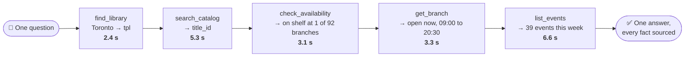

These are real calls and timings from `npm run e2e` against Toronto Public Library:

```text
find_library({ query: "Toronto" })                                              2.4 s
  → tpl = Toronto Public Library
search_catalog({ library: "tpl", query: "Project Hail Mary", format: "book" })  5.3 s
  → "Project Hail Mary", Book, 2021: 178 holds on 216 copies
check_availability({ library: "tpl", title_id: "S234C3970025" })                3.1 s
  → on the shelf at 1 of 92 branches: North York Central Library
get_branch({ library: "tpl", branch: "North York Central Library" })            3.3 s
  → open now, 09:00 to 20:30, 18 services
list_events({ library: "tpl", branch: "North York Central Library",
              start_date: "2026-11-12", end_date: "2026-11-19" })               6.6 s
  → 39 events
```

<details>
<summary><h3>👉 Click to view a real <code>check_availability</code> result</h3></summary>

Trimmed to one branch and two copies:

```json
{
  "library": "tpl",
  "title_id": "S234C3970025",
  "title": "Project Hail Mary",
  "format": { "code": "BK", "label": "Book" },
  "summary": { "status": "available", "total_copies": 216, "available_copies": 2, "holds": 178, "on_order_copies": 0 },
  "branches_holding": 92,
  "branches_on_shelf": 1,
  "branches": [
    {
      "branch_code": "CL",
      "branch_name": "North York Central Library",
      "copies_total": 8,
      "copies_on_shelf": 1,
      "next_due_date": "2026-11-19",
      "copies": [
        { "status": "on_shelf", "status_label": "Available Not Holdable", "collection": "Browsery 1st Fl Fiction", "call_number": "SCIENCE FICTION WEI", "due_date": null },
        { "status": "checked_out", "status_label": "On Loan", "collection": "Lang & Lit 3rd Fl Fiction", "call_number": "SCIENCE FICTION WEI", "due_date": "2026-11-28" }
      ]
    }
  ],
  "truncated": true,
  "source": { "engines": ["browser"], "url": "https://tpl.bibliocommons.com/v2/record/S234C3970025", "cached": false, "retrieved_at": "2026-11-12T01:07:45.256Z" }
}
```

</details>

<p align="right"><a href="#stacks"><sub>↑ Back to top</sub></a></p>


## 🎯 Why it exists

Public libraries publish no API for developers. Their catalogues, branch pages and event calendars are websites built for people. Stacks uses [TinyFish](https://tinyfish.ai) to read and operate those sites, and hands the agent clean, structured data.

<table>
<tr><td>

**One server, many library systems**
- Targets [BiblioCommons](https://www.bibliocommons.com), the platform behind 200+ public library systems
- **54 systems verified live**: 33 in the US, 20 in Canada, 1 in New Zealand
- `find_library` discovers others on demand

</td><td>

**Typed in, typed out**
- **14 tools**, each with a Zod input schema and output schema
- Structured data only, never a page dump
- Every result carries a `source`: which TinyFish endpoints, which URL, when

</td></tr>
<tr><td>

**Live, not indexed**
- Copy-level availability, hold queues, today's hours and this week's events
- Read from the site at the moment you ask
- Repeat calls answered from a short cache in under 20 ms

</td><td>

**Breaks loudly**
- A site change returns a typed `SITE_CHANGED` error naming the broken field
- "Nothing found" and "broken" are never confused
- A health check and a daily CI canary catch changes early

</td></tr>
</table>

### Why not just let the agent search the web?

| | Web search in ChatGPT or Claude | Stacks |
|---|---|---|
| "Is it on the shelf at my branch?" | Cannot see it. Availability loads with JavaScript and is not in any search index. | Copy-level status per branch, with call numbers and due dates |
| Freshness | Days or weeks old | Read at call time |
| Filtering | Whatever the snippet shows | Typed filters: branch, date range, audience, format |
| Multi-step tasks | Guesses between steps | Chains real ids: search → availability → branch hours → events |
| When the site changes | Confidently stale | A typed error and a failing health check |

<p align="right"><a href="#stacks"><sub>↑ Back to top</sub></a></p>


## 🧰 Tools

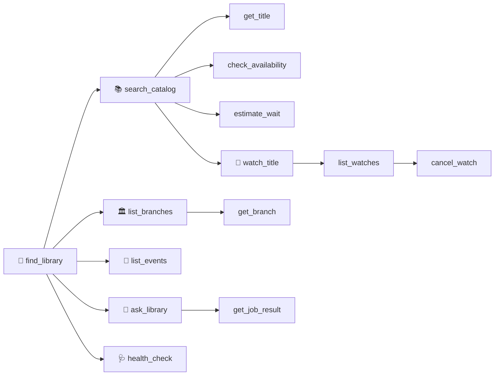

| Tool | What it does | TinyFish endpoint |
|---|---|---|
| `find_library` | City or library name → `library_id` | Fetch (plus Search for libraries outside the directory) |
| `search_catalog` | Search books, eBooks, audiobooks, DVDs. Typed titles with availability and hold counts | Browser |
| `get_title` | Description, contributors, publisher, ISBNs, subjects, other formats | Browser |
| `check_availability` | Copy-level availability by branch: on shelf, checked out, due dates, call numbers | Browser |
| `estimate_wait` | Estimated wait if you place a hold today, and formats with a shorter queue | Browser |
| `list_branches` | Branches with address, today's hours, open-now, distance from a point | Browser |
| `get_branch` | Weekly hours, holiday closures, services, accessibility, parking | Browser |
| `list_events` | Programs filtered by branch, dates, audience and type | Browser |
| `ask_library` | Open questions about services and policies, answered from the library's own site | Search → Fetch → Agent |
| `get_job_result` | Result of a slow Agent run | Agent |
| `watch_title` | Standing watch that detects when a title's availability changes | Monitor |
| `list_watches` | Your watches, with live availability on request | Monitor |
| `cancel_watch` | Delete a watch (`dry_run` previews it) | Monitor |
| `health_check` | Proves every tool still works, or reports exactly what broke | Fetch + Browser + Agent |

Full input and output schemas: [docs/TOOLS.md](docs/TOOLS.md), generated from the code. Twelve tools are read-only; `watch_title` and `cancel_watch` create and delete a watch, and are annotated as such for clients.

<p align="right"><a href="#stacks"><sub>↑ Back to top</sub></a></p>


## 🏗 System architecture

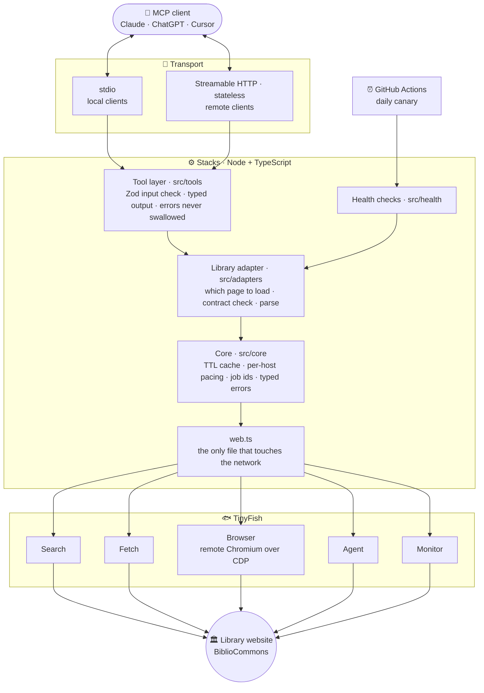

| Layer | Responsibility | Where |
|---|---|---|
| **Transport** | Speak MCP over stdio or stateless HTTP; decide whose TinyFish key a request uses | [`src/index.ts`](src/index.ts), [`src/http.ts`](src/http.ts) |
| **Tools** | The 14 tools: validate input, call the adapter, shape typed output | [`src/tools/`](src/tools) |
| **Adapter** | Everything specific to one library platform: URLs, the page contract, parsing | [`src/adapters/bibliocommons/`](src/adapters/bibliocommons) |
| **Public model** | Platform-independent shapes every adapter returns | [`src/schemas.ts`](src/schemas.ts) |
| **Core** | Cache, pacing, job ids, error codes, tool registration | [`src/core/`](src/core) |
| **Web** | The five TinyFish endpoints behind one interface, with a warm browser, deadlines and retries | [`src/core/web.ts`](src/core/web.ts) |
| **Health** | Live checks that prove each tool still works | [`src/health/`](src/health) |

<details>
<summary><h3>🗂️ Project structure</h3></summary>

```
src/
  index.ts     CLI entry: stdio server, --http server, `health` command
  http.ts      Streamable HTTP transport and its access checks
  server.ts    Builds the MCP server and registers every tool
  schemas.ts   The public, platform-independent data model
  core/        Site-agnostic: TinyFish client, cache, typed errors, jobs, tool registration
  adapters/
    types.ts   The LibraryAdapter interface every platform implements
    bibliocommons/
      contracts.ts   The fields Stacks depends on (the "breaks loudly" contract)
      parse.ts       Pure functions: page data → public data model
      adapter.ts     Which pages to load and how
      registry.json  Verified libraries
  tools/       The 14 MCP tools
  health/      Canaries and the health report
test/          Offline tests on recorded pages, plus the tool contract snapshot
scripts/       Live end-to-end run, QA matrix, registry refresh, docs generator
docs/          Tool reference, architecture notes, adapter guide
```

</details>

More in [docs/ARCHITECTURE.md](docs/ARCHITECTURE.md).

<p align="right"><a href="#stacks"><sub>↑ Back to top</sub></a></p>


## 🛰 How one call travels

The full path of one `check_availability` call, from the client to the library's website and back.

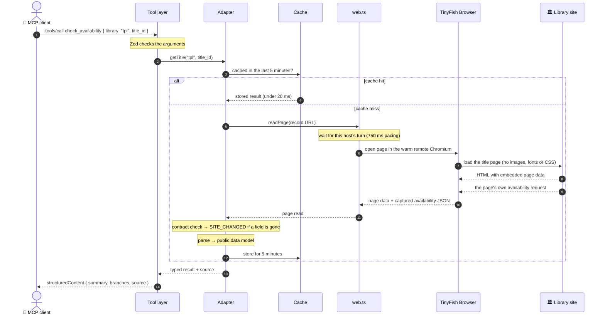

**How a BiblioCommons page is read.** The site renders its data into a JSON `<script>` element in the page. TinyFish Fetch returns cleaned text, which drops script tags, so Stacks uses TinyFish Browser to load the page in a remote Chromium and read that element. Per-branch availability is not in the page: the title page requests it in the background, and Stacks reads that response as it arrives. It never calls that address itself.

| Measured latency (live, Toronto Public Library) | |
|---|---|
| `search_catalog`, `check_availability`, `get_branch` | 2 to 5 s |
| `list_events` with filters | 5 to 7 s |
| Any repeat call within the cache window | under 20 ms |
| `ask_library` | 1 to 3 minutes (returns a `job_id` after about 50 s) |

<p align="right"><a href="#stacks"><sub>↑ Back to top</sub></a></p>


## 🐟 How TinyFish is used

Every network call Stacks makes is a TinyFish call. There is no canned data and no other scraping stack. All five endpoints do real work, and each is picked for what it is best at.

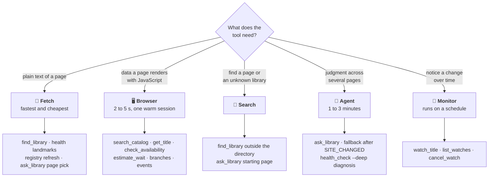

**Fetch** reads pages as clean text. It is the fastest and cheapest endpoint, so Stacks uses it wherever plain text is enough:
- `find_library` confirms a catalogue is live and reads the library's name.
- `ask_library` reads the candidate pages found by Search and picks the best one as the Agent's starting point, which keeps Agent runs short.
- `health_check` fetches each page and checks that its landmark sections are still there. This is the first, cheapest layer of change detection.
- The directory of 54 libraries is built and re-verified with Fetch (`npm run refresh-registry`).

**Agent** navigates and reasons. It is much slower (1 to 3 minutes for a full answer), so Stacks gives it the jobs that need judgment:
- `ask_library` answers open questions ("How do I get a card as a non-resident?") by browsing the library's own website and returning an answer with its source URLs.
- **Fallback.** If a fast tool hits `SITE_CHANGED`, Stacks starts an Agent run to read the page anyway and returns its `fallback_job_id` inside the error. The break is still reported either way. The fallback is best-effort: in testing the Agent sometimes read no rows from a page, and Stacks reports such a run as a failed job, never as an empty result.
- **Diagnosis.** `health_check --deep` sends an Agent to a failing page to describe what changed, so the maintainer starts with an explanation.

**Browser** runs a remote Chromium that Stacks drives over CDP. BiblioCommons renders its data with JavaScript, so Fetch alone sees an empty shell. One warm browser session is reused across calls, replaced after 4 minutes, and every page read has an 80-second deadline.

**Search** finds library catalogues that are not in the built-in directory, and finds the right page on a library's website for `ask_library`.

**Monitor** powers `watch_title`: TinyFish re-reads a title's page on a schedule, detects changes, and notifies a webhook or the TinyFish dashboard.

### Slow work becomes a job

Agent runs can outlast a client's tool timeout, so Agent tools wait up to 40 seconds and then return a `job_id` for `get_job_result`.

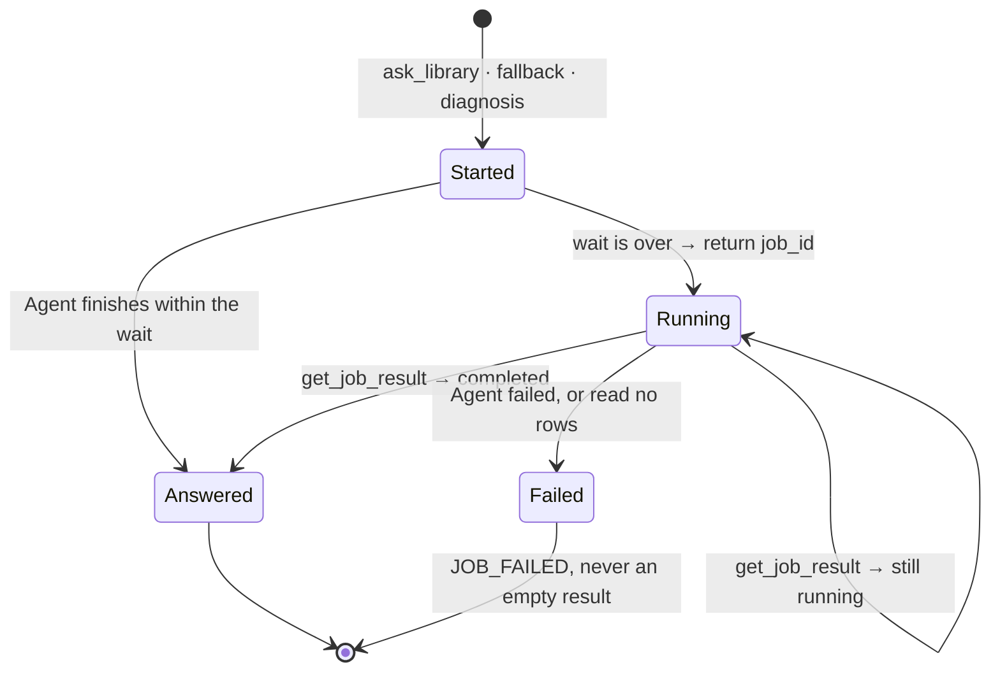

A job id is `<kind>.<TinyFish run id>`. Nothing about the job is stored in Stacks, so jobs survive a restart and work across server instances.

<p align="right"><a href="#stacks"><sub>↑ Back to top</sub></a></p>


## 🚨 Breaks loudly

Websites change. A scraper that quietly returns an empty list is worse than one that crashes, because the agent will tell the user "there are no copies" when the truth is "I can't tell". Stacks is built so that cannot happen.

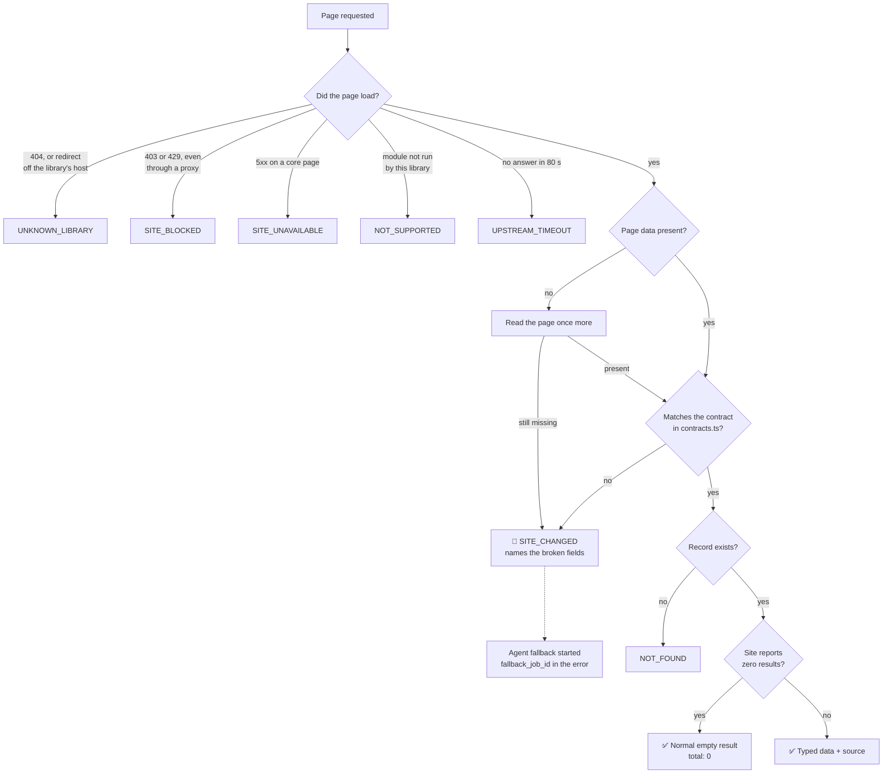

**1. A contract for every page.** [`contracts.ts`](src/adapters/bibliocommons/contracts.ts) declares exactly which fields Stacks depends on. Every page read is validated against it. If a field is renamed or removed, the tool fails.

<details>
<summary><h3>👉 Click to view a real <code>SITE_CHANGED</code> error</h3></summary>

From a test that removes `title` from a recorded search page:

```json
{
  "error": {
    "code": "SITE_CHANGED",
    "message": "The site's search page data no longer matches what Stacks expects (12 field problems).",
    "hint": "The website changed. Run the health_check tool for a full report and open an issue at https://github.com/VivekSalwan2000/stacks-mcp/issues.",
    "retryable": false,
    "details": {
      "tool": "search_catalog",
      "contract": "search page",
      "url": "https://tpl.bibliocommons.com/v2/search?query=dune&searchType=smart",
      "broken_fields": [
        "entities.bibs.S234C2504662.briefInfo.title: Invalid input: expected string, received undefined",
        "entities.bibs.S234C3943037.briefInfo.title: Invalid input: expected string, received undefined"
      ],
      "fallback_job_id": "search.00000000-0000-4000-8000-000000000001",
      "fallback": "A slower TinyFish Agent run was started to read the page instead. Poll get_job_result with fallback_job_id. Its result is best-effort and not schema-validated."
    }
  }
}
```

</details>

**2. "No results" and "broken" are different answers.** A search for nonsense returns `total: 0`. A page that lost its data returns `SITE_CHANGED`. A results list that points at records missing from the page is an error, never a shorter list.

**3. Four layers of change detection**, from cheapest to deepest:

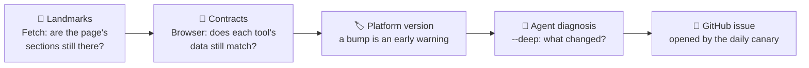

```bash
npx stacks-mcp health --library tpl
```

```text
Stacks health check: tpl
Healthy: 9 passed, 0 warning(s), 0 skipped.

  [PASS] locations page is reachable and intact  (fetch)
  [PASS] events page is reachable and intact  (fetch)
  [PASS] search page is reachable and intact  (fetch)
  [PASS] search_catalog returns typed results  (browser)
         367 results; first: "Harry Potter and the Philosopher's Stone" (Book)
  [PASS] search_catalog tells 'no results' apart from 'broken'  (browser)
  [PASS] check_availability returns copy-level data  (browser)
  [PASS] list_branches returns branches with hours  (browser)
         101 branches; 64 open now
  [PASS] list_events returns typed events  (browser)
         5980 upcoming events; 6 audiences, 27 event types
  [PASS] platform version  (browser)
         BiblioCommons 9.38.3 (the verified version)
```

It exits non-zero when anything fails. The same check is the `health_check` tool, so an agent can run it mid-conversation.

**4. A daily canary in CI.** [`canary.yml`](.github/workflows/canary.yml) runs the health check against three libraries every day. When it fails, it opens an issue containing the report and an Agent diagnosis job.

**5. Tests that simulate site changes.** [`test/breaks-loudly.test.ts`](test/breaks-loudly.test.ts) mutates recorded pages (renames a field, drops the data, removes the availability request) and asserts that each tool fails with the right error. These run offline in CI on every push.

| Error code | Meaning |
|---|---|
| `INVALID_INPUT` | The arguments were wrong. Fix them and call again |
| `UNKNOWN_LIBRARY` | No such library on this platform. Use `find_library` first |
| `NOT_FOUND` | The library has no record of that title, branch or event |
| `NOT_SUPPORTED` | This library does not run that part of the platform |
| `SITE_CHANGED` | The website no longer matches the contract. The tool is broken until it is updated |
| `SITE_UNAVAILABLE` | The library website returned a server error |
| `SITE_BLOCKED` | The website refused the request (bot protection or geo-block) |
| `UPSTREAM_TIMEOUT` | The website or TinyFish took too long |
| `RATE_LIMITED` | Too many requests. Wait and retry |
| `TINYFISH_ERROR` | TinyFish returned an error |
| `CONFIG_ERROR` | Stacks is not configured correctly |
| `JOB_FAILED` | A background Agent run failed |

Every error comes as `{ error: { code, message, hint } }`, and the `hint` says what to do next.

<p align="right"><a href="#stacks"><sub>↑ Back to top</sub></a></p>


## 🧬 Data model

The public model is platform-independent on purpose: an adapter for another library platform returns the same shapes. These are the main objects tools return, defined in [`src/schemas.ts`](src/schemas.ts).

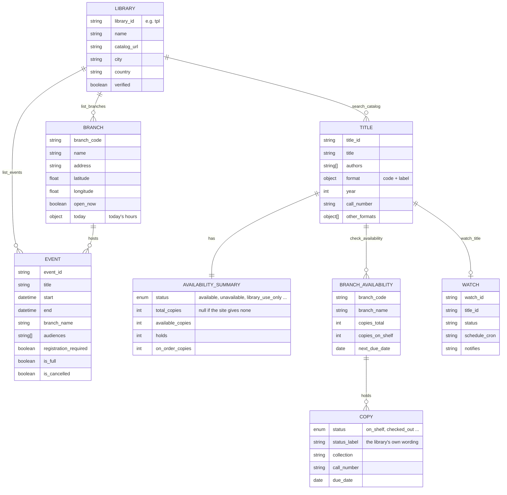

Every tool result also carries a **`source`** object, so an answer can always be traced:

| Field | Meaning |
|---|---|
| `engines` | Which TinyFish endpoints produced the data, for example `["browser"]` |
| `url` | The library page it was read from |
| `cached` | Whether it came from Stacks's short cache |
| `retrieved_at` | When it was read from the site |

<p align="right"><a href="#stacks"><sub>↑ Back to top</sub></a></p>


## 🗄 Where state lives

**Stacks has no database.** It stores nothing on disk and keeps no user data. Everything it knows is either read from the library's site at call time, held briefly in memory, or kept by TinyFish.

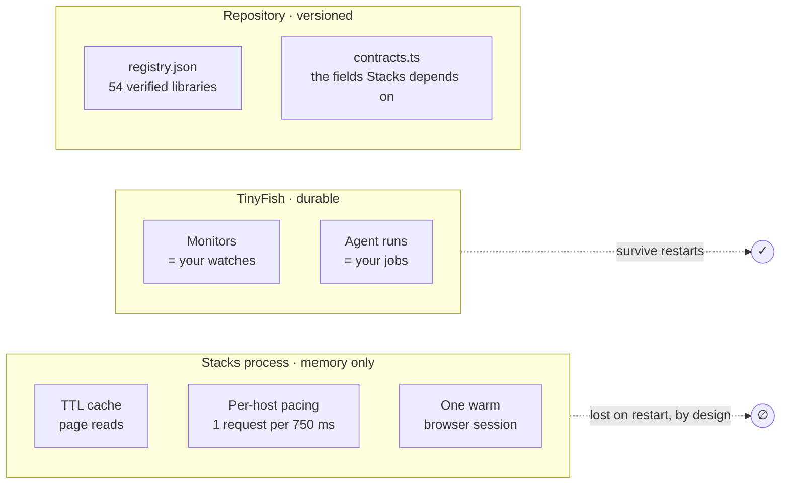

| What | Where it lives | Lifetime |
|---|---|---|
| Availability of a title | Memory cache | 5 minutes |
| Search results | Memory cache | 10 minutes |
| Events | Memory cache | 30 minutes |
| Branches and hours | Memory cache | 60 minutes |
| A library's identity | Memory cache | 24 hours |
| Watches | TinyFish Monitors. The monitor's name encodes the library and title, so there is no watch table | Until cancelled |
| Agent jobs | TinyFish runs. The job id contains the run id, so there is no job table | Kept by TinyFish |
| The library directory | [`registry.json`](src/adapters/bibliocommons/registry.json) in the repo | Updated by pull request |
| Your TinyFish key | An environment variable, or a request header in HTTP mode | Never written to disk or logged |

<p align="right"><a href="#stacks"><sub>↑ Back to top</sub></a></p>


## 🧮 The wait estimate

`estimate_wait` answers *"if I place a hold today, how long until I get it?"* The library's site does not say, so Stacks computes an estimate from what the site does show, and labels it as an estimate.

Inputs, all read live from the title page:

- $h$: the number of holds already in the queue
- $n$: the number of circulating copies (copies for in-library use and copies on order are left out)
- $r_1 \le r_2 \le \dots \le r_n$: days until each copy is back and ready, which is days to its due date plus 3 for transit and pickup (3 if it has no due date)
- $\ell$: the loan period in days (`loan_days`, default 21)

Your place in the queue and the length of one lending cycle are:

$$p = h + 1 \qquad c = \ell + 3$$

Copies come back in order and each goes to the next person in the queue. Person $p$ gets the copy at position $((p-1) \bmod n) + 1$, after the queue has gone all the way round $\lfloor (p-1)/n \rfloor$ times:

$$\text{likely} = r_{\,((p-1) \bmod n)+1} + \left\lfloor \frac{p-1}{n} \right\rfloor \cdot c$$

The range allows for early returns and renewals:

$$\text{low} = \max\bigl(1,\ \operatorname{round}(0.6 \cdot \text{likely})\bigr) \qquad \text{high} = \operatorname{round}(1.4 \cdot \text{likely}) + 3$$

**Worked example (illustrative numbers).** Two copies, due in 4 and 10 days, with 5 holds and a 21-day loan:

| Step | Value |
|---|---|
| Ready in | $r = [7, 13]$ days |
| Your position | $p = 5 + 1 = 6$ |
| Cycle | $c = 21 + 3 = 24$ days |
| Which copy | $((6-1) \bmod 2) + 1 = 2$, so $r_2 = 13$ |
| Full rounds first | $\lfloor 5/2 \rfloor = 2$ |
| **Likely wait** | $13 + 2 \cdot 24 = 61$ days |
| Range | 37 to 88 days |

Special cases: if a copy is on the shelf, the wait is 0 and the result names the branches. If the library has no circulating copies, the estimate is `null` and the result says why. The tool also lists other formats of the same title with a shorter queue per copy.

<p align="right"><a href="#stacks"><sub>↑ Back to top</sub></a></p>


## 🧱 Tech stack

| Area | Choice | Why |
|---|---|---|
| Language | TypeScript 5.7, strict, ES modules | Types flow from the Zod schemas to every tool |
| Runtime | Node.js 20 or newer | Runs anywhere `npx` does |
| Protocol | [`@modelcontextprotocol/sdk`](https://github.com/modelcontextprotocol/typescript-sdk) 1.32 | stdio and stateless Streamable HTTP from one codebase |
| Web access | [`@tiny-fish/sdk`](https://www.npmjs.com/package/@tiny-fish/sdk) 0.11 | Search, Fetch, Browser, Agent and Monitor |
| Browser control | `playwright-core` 1.48, connected over CDP | Drives TinyFish's remote Chromium. No browser is installed locally |
| Schemas | Zod 4 | One definition gives validation, types and JSON Schema |
| Database | None | See [Where state lives](#-where-state-lives) |
| Tests | Vitest 4, v8 coverage | 71 offline tests on recorded pages |
| Lint | ESLint 9 + typescript-eslint | `console.log` is an error in `src/`: stdout carries the protocol |
| CI | GitHub Actions on Node 20 and 22 | Lint, typecheck, tests with a coverage floor, build |
| Monitoring | A scheduled GitHub Actions canary | Opens an issue when a library site changes |
| Packaging | npm (`stacks-mcp`), Docker, `render.yaml` | `npx` for local clients, a container for remote ones |

### How it is tested

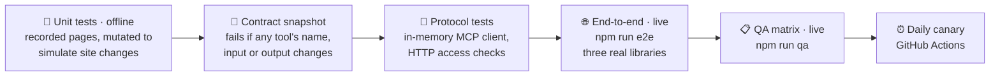

The first three run on every push with no network and no key. The last three call real library sites through TinyFish.

<p align="right"><a href="#stacks"><sub>↑ Back to top</sub></a></p>


## 🚀 Quick start

You need Node 20+ and a [TinyFish API key](https://agent.tinyfish.ai).

### Claude Desktop

Add this to `claude_desktop_config.json` (Settings → Developer → Edit Config), then restart Claude:

```json
{
  "mcpServers": {
    "stacks": {
      "command": "npx",
      "args": ["-y", "stacks-mcp"],
      "env": { "TINYFISH_API_KEY": "your-key" }
    }
  }
}
```

### Claude Code

```bash
claude mcp add stacks -e TINYFISH_API_KEY=your-key -- npx -y stacks-mcp
```

### Cursor, Windsurf and other stdio clients

Use the same `command`, `args` and `env` as the Claude Desktop block above.

### ChatGPT and other remote clients

ChatGPT connects to MCP servers over HTTPS, so run Stacks in HTTP mode on a host:

```bash
TINYFISH_API_KEY=your-key STACKS_HTTP_TOKEN=choose-a-secret npx -y stacks-mcp --http
```

Your MCP URL is `https://<your-host>/mcp/<your-secret>`. In ChatGPT: Settings → Connectors → Advanced → Developer mode, then add a connector with that URL and no authentication. To deploy on Render's free tier, use the included [`render.yaml`](render.yaml) and [`Dockerfile`](Dockerfile).

### From source

```bash
git clone https://github.com/VivekSalwan2000/stacks-mcp.git
cd stacks-mcp
npm install
cp .env.example .env        # then put your TinyFish key in .env
npm run build
npm run e2e                 # calls every core tool against three live libraries
```

<p align="right"><a href="#stacks"><sub>↑ Back to top</sub></a></p>


## ⚙️ Configuration

| Variable | Default | Purpose |
|---|---|---|
| `TINYFISH_API_KEY` | required | Your TinyFish key |
| `STACKS_DEFAULT_LIBRARY` | none | Library id used when a call omits `library` |
| `STACKS_PROXY` | `auto` | `off`, `auto` (retry through a TinyFish proxy if blocked), `tinyfish`, or a country code |
| `STACKS_AGENT_WAIT_MS` | `40000` | How long Agent tools wait before returning a `job_id` |
| `STACKS_HTTP_TOKEN` | none | Secret required by `--http` mode when it uses the server's own key |
| `PORT` | `3000` | Port for `--http` mode |
| `HOST` | see below | Address `--http` mode listens on |

### Who gets in over HTTP

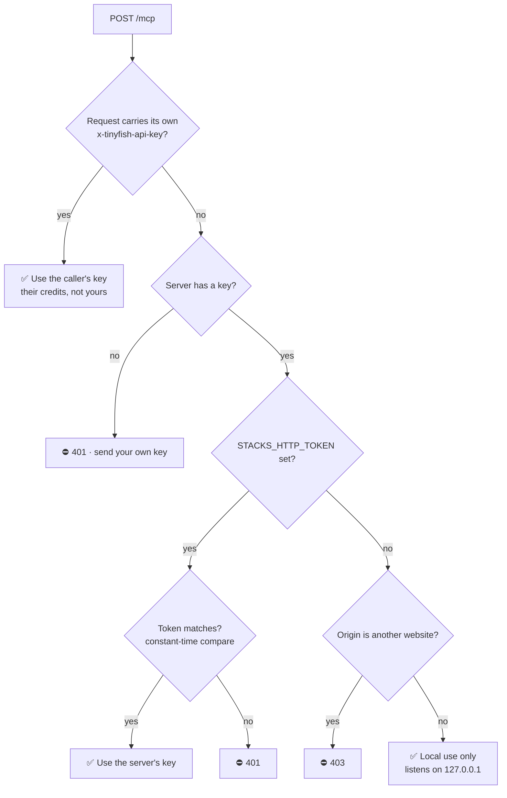

Arguments that do not match a tool's input schema are rejected by the MCP layer before the tool runs, with a plain message naming the field (for example `Too big: expected number to be <=50 at page`). Every other failure uses the structured `{ error: { code, message, hint } }` format.

<p align="right"><a href="#stacks"><sub>↑ Back to top</sub></a></p>


## 🤝 Contributing

Contributions are welcome, and the project is laid out to make them small. Pick the path that fits:

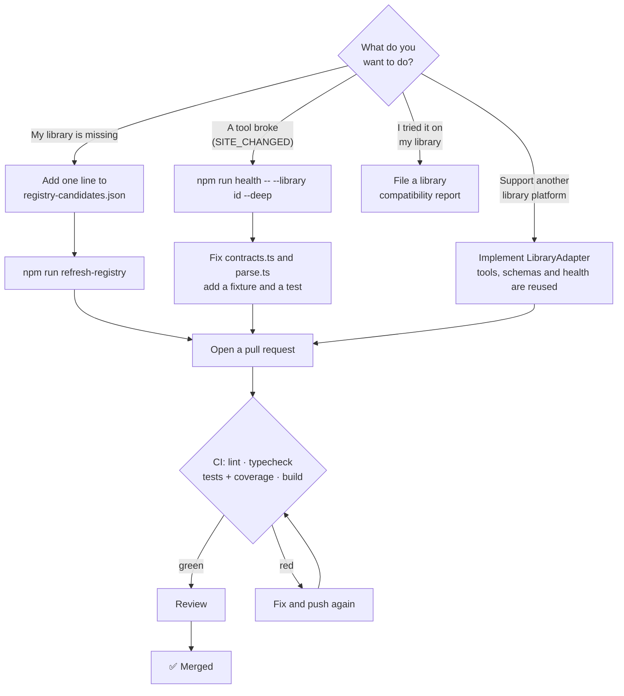

| I want to… | Start here |
|---|---|
| Add a library to the directory | One line in [`scripts/registry-candidates.json`](scripts/registry-candidates.json), then `npm run refresh-registry` |
| Fix a break | Usually a few lines in `contracts.ts` and `parse.ts`, plus a new fixture |
| Add a platform (Aspen Discovery, Koha, Polaris, Evergreen) | [docs/ADDING_AN_ADAPTER.md](docs/ADDING_AN_ADAPTER.md) |
| Report how a library behaves | A [library compatibility report](https://github.com/VivekSalwan2000/stacks-mcp/issues/new?template=library-report.yml), whether it worked or not |
| Report a security problem | [SECURITY.md](SECURITY.md), privately |

Project documents: [CONTRIBUTING.md](CONTRIBUTING.md) · [CODE_OF_CONDUCT.md](CODE_OF_CONDUCT.md) · [SECURITY.md](SECURITY.md) · [CHANGELOG.md](CHANGELOG.md) · [LICENSE](LICENSE)

### Roadmap

- Adapters for Aspen Discovery and Koha
- Opt-in account actions (holds, renewals) using TinyFish Vault, with the user's explicit consent
- A `nearest_copy` tool that combines availability, distance and opening hours
- Branch-level watches

<p align="right"><a href="#stacks"><sub>↑ Back to top</sub></a></p>


## 🌱 Responsible use and limits

Stacks is a guest on library websites, and it behaves like one:

- **Read-only.** It never logs in, places holds, registers for events or submits forms. It needs no library card and handles no personal data.
- **On demand.** It loads a page when a person asks a question. It does not crawl.
- **Light.** Results are cached, requests to one host are spaced out, and images, fonts and stylesheets are never downloaded.
- **Only public pages.** It loads the same pages a visitor would, and stays off paths that `robots.txt` disallows.
- **Staff-only fields stay private.** Page data sometimes includes internal notes. Stacks reads only the fields in its contract, and a test asserts the rest never appears in output.

Limits:

- **BiblioCommons libraries only**, for now. Libraries on other platforms return an empty `find_library` result. New platforms are added as adapters: see [Contributing](#-contributing).
- **No account actions.** Placing holds and renewing need a login, which Stacks does not do.
- **Some libraries block automated browsers.** New York Public Library currently does. Stacks reports `SITE_BLOCKED` rather than guessing.
- **Not every library uses every module.** Seattle, for example, runs its events and branch pages elsewhere. Those tools return `NOT_SUPPORTED` there, and `ask_library` still works.
- **`estimate_wait` is an estimate** computed from queue length and due dates. It says so in its output.

<p align="right"><a href="#stacks"><sub>↑ Back to top</sub></a></p>

---

<div align="center">

**Built for the [TinyFish](https://tinyfish.ai) Student Bounty, Drop 002 · *Site to MCP***

MIT licensed · by Vivek Salwan

<sub>Stacks is an independent open-source project. It is not affiliated with or endorsed by BiblioCommons or any library.</sub>

</div>
