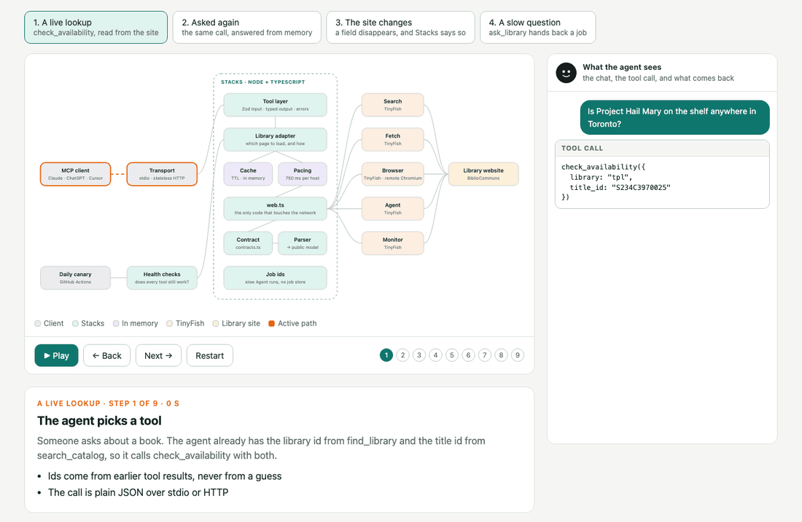
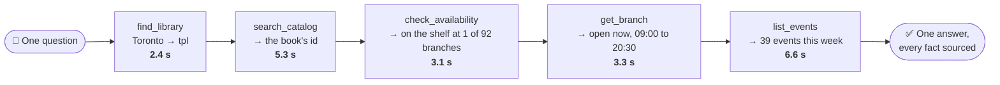
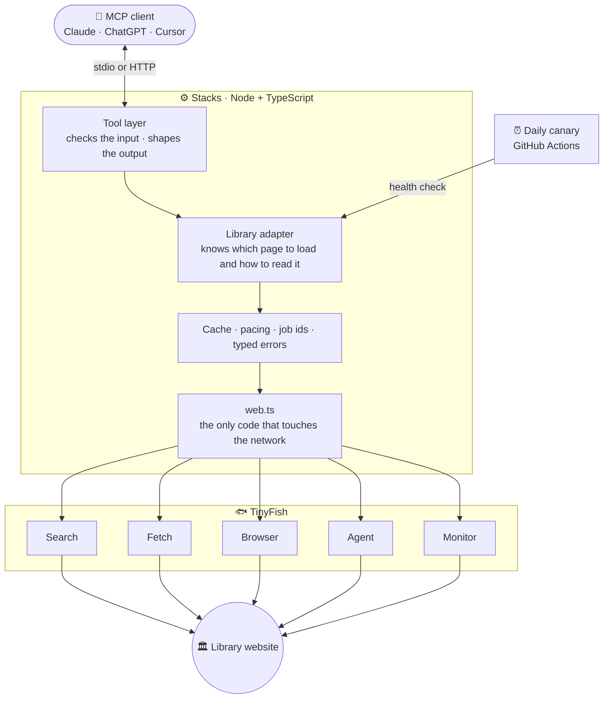
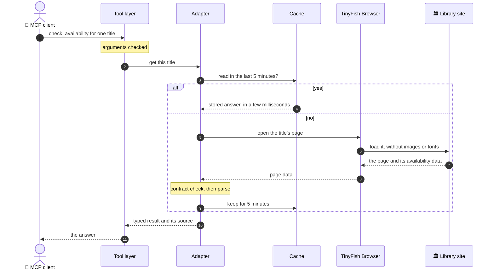
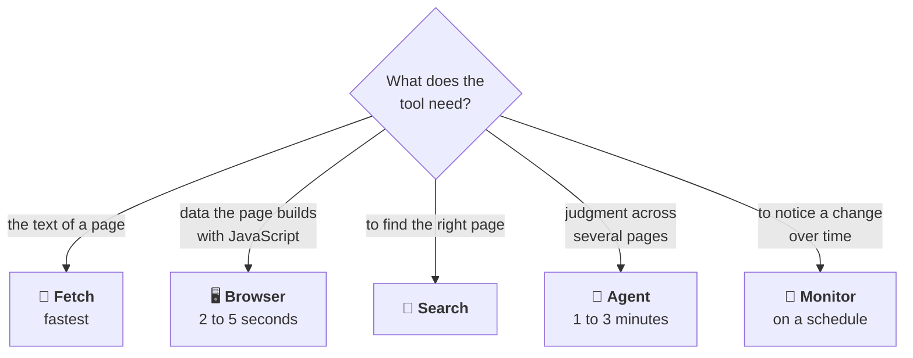
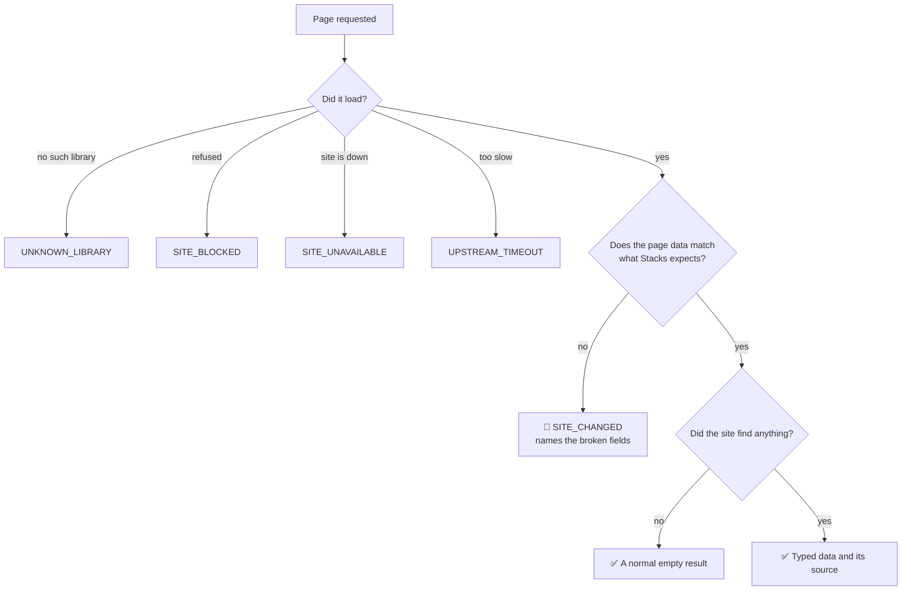
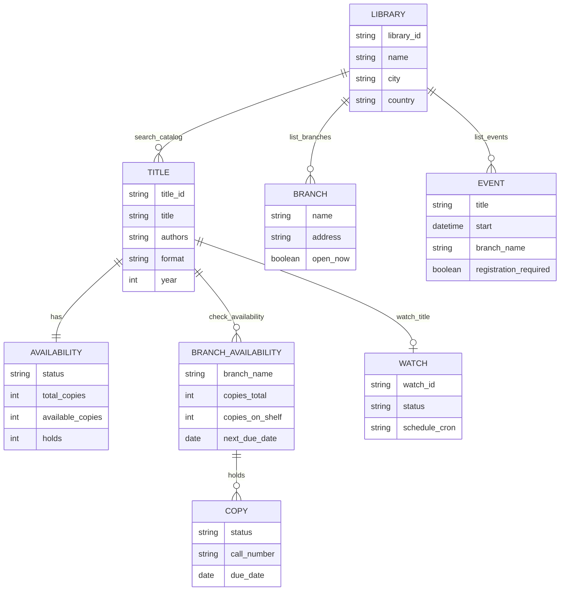

<div align="center">


# Stacks

### Give your AI agent a library card.

**Stacks is an MCP server that lets Claude, ChatGPT and other AI agents look things up at your public library: what's on the shelf, which branch is open, what's on this week. It reads the library's website live, every time you ask.**

<br>


[](https://www.npmjs.com/package/stacks-mcp)
[](https://github.com/VivekSalwan2000/stacks-mcp/actions/workflows/ci.yml)
[](https://github.com/VivekSalwan2000/stacks-mcp/actions/workflows/canary.yml)
[](LICENSE)
[](CONTRIBUTING.md)

[**▶ Try the interactive explorer**](https://viveksalwan2000.github.io/stacks-mcp/architecture.html) · [**Tools**](#-tools) · [**How it works**](#-how-it-works) · [**Run it**](#-quick-start) · [**Contribute**](#-contributing)

<br>

<a href="https://viveksalwan2000.github.io/stacks-mcp/architecture.html">
  
</a>

**[🧭 Open the interactive explorer](https://viveksalwan2000.github.io/stacks-mcp/architecture.html)**<br>
<sub>Watch one question travel through Stacks, step by step. No install and no key needed: it replays recorded results.</sub>

</div>

<table>
<tr>
<td valign="top" width="33%">

**🟢 Product**<br>
<code>01</code> <a href="#-see-it-work">See it work</a><br>
<code>02</code> <a href="#-why-it-exists">Why it exists</a><br>
<code>03</code> <a href="#-tools">Tools</a>

</td>
<td valign="top" width="33%">

**🟠 How it works**<br>
<code>04</code> <a href="#-how-it-works">How it works</a><br>
<code>05</code> <a href="#-how-tinyfish-is-used">How TinyFish is used</a><br>
<code>06</code> <a href="#-breaks-loudly">Breaks loudly</a><br>
<code>07</code> <a href="#-what-comes-back">What comes back</a><br>
<code>08</code> <a href="#-the-wait-estimate">The wait estimate</a>

</td>
<td valign="top" width="33%">

**🟣 Build and run**<br>
<code>09</code> <a href="#-tech-stack">Tech stack</a><br>
<code>10</code> <a href="#-quick-start">Quick start</a><br>
<code>11</code> <a href="#-contributing">Contributing</a><br>
<code>12</code> <a href="#-responsible-use-and-limits">Responsible use and limits</a>

</td>
</tr>
</table>


## 🎬 See it work

*"I'm in Toronto. Is Project Hail Mary on the shelf anywhere, is that branch open now, and what's on there this week?"*

To answer that, the agent makes five tool calls. Each one hands a real id to the next, so nothing is guessed along the way.



Those timings are from a real run against Toronto Public Library. The answer the agent could give: one copy is on the shelf at North York Central Library, which is open until 8:30 tonight and has 39 programs this week.

<p align="right"><a href="#stacks"><sub>↑ Back to top</sub></a></p>


## 🎯 Why it exists

Public libraries don't offer developers an API. Their catalogues, branch pages and event calendars are websites made for people. Stacks uses [TinyFish](https://tinyfish.ai) to read those sites and gives the agent clean, structured data instead.

<table>
<tr><td>

**One server, many libraries**
- Works with [BiblioCommons](https://www.bibliocommons.com), the platform behind 200+ public library systems
- **54 systems verified live**: 33 in the US, 20 in Canada, 1 in New Zealand
- Others are found on demand

</td><td>

**Typed in, typed out**
- **14 tools**, each with a defined input and output
- Structured data, never a dump of a web page
- Every answer says where it came from and when

</td></tr>
<tr><td>

**Live, not indexed**
- Shelf status, hold queues, today's hours, this week's events
- Read from the site at the moment you ask
- No library card or login needed

</td><td>

**Honest when it breaks**
- If a library changes its website, the tool says so and names what broke
- "Nothing found" and "I can't tell" are never mixed up
- A daily check catches changes early

</td></tr>
</table>

**Why not just let the agent search the web?**

| | Web search in a chat app | Stacks |
|---|---|---|
| "Is it on the shelf at my branch?" | Can't see it. Shelf status loads after the page does and isn't in any search index | Each copy at each branch, with call number and due date |
| Freshness | Days or weeks old | Read when you ask |
| Follow-up steps | Guesses between steps | Passes real ids from one tool to the next |
| When the site changes | Confidently out of date | A clear error and a failing health check |

<p align="right"><a href="#stacks"><sub>↑ Back to top</sub></a></p>


## 🧰 Tools

| Tool | What it does | TinyFish endpoint |
|---|---|---|
| `find_library` | Turns a city or library name into a library id | Fetch, Search |
| `search_catalog` | Searches books, eBooks, audiobooks and DVDs | Browser |
| `get_title` | Full details for one title, and its other formats | Browser |
| `check_availability` | Which branches have a copy on the shelf right now | Browser |
| `estimate_wait` | How long you'd wait if you placed a hold today | Browser |
| `list_branches` | Branches with address, today's hours and distance | Browser |
| `get_branch` | One branch's weekly hours, closures and services | Browser |
| `list_events` | Programs, filtered by branch, date, audience and type | Browser |
| `ask_library` | Open questions about services and policies | Search, Fetch, Agent |
| `get_job_result` | Collects the answer from a slow Agent run | Agent |
| `watch_title` | Watches a title and notices when availability changes | Monitor |
| `list_watches` | Your watches | Monitor |
| `cancel_watch` | Removes a watch, with a preview option | Monitor |
| `health_check` | Proves every tool still works, or says what broke | Fetch, Browser, Agent |

Twelve of the fourteen only read. The two watch tools create and remove a watch, and are labelled that way for the client. Every input and output field is listed in [docs/TOOLS.md](docs/TOOLS.md).

<p align="right"><a href="#stacks"><sub>↑ Back to top</sub></a></p>


## 🏗 How it works



A call comes in from the client and passes through four layers. The **tool layer** checks the arguments. The **adapter** knows which library page answers the question. The **core** decides whether a recent answer can be reused and keeps requests to one site spaced out. Then **web.ts** asks TinyFish to do the actual reading. On the way back, the page data is checked against a contract before it is turned into the answer.

| Layer | What it is responsible for | Code |
|---|---|---|
| Transport | Talking MCP over stdio or HTTP, and deciding whose TinyFish key a request uses | [`src/index.ts`](src/index.ts), [`src/http.ts`](src/http.ts) |
| Tools | The 14 tools | [`src/tools/`](src/tools) |
| Adapter | Everything specific to one library platform | [`src/adapters/bibliocommons/`](src/adapters/bibliocommons) |
| Core | Cache, pacing, jobs, errors | [`src/core/`](src/core) |
| Health | Live checks that each tool still works | [`src/health/`](src/health) |

**There is no database.** Stacks writes nothing to disk and keeps no user data. Recent answers sit in memory for a few minutes (5 for availability, 10 for search, 30 for events, 60 for branches) and are gone on restart. Watches and slow jobs are kept by TinyFish, so they survive a restart without Stacks storing anything.

<details>
<summary><b>👉 The path of one call, step by step</b></summary>

<br>



The [interactive explorer](https://viveksalwan2000.github.io/stacks-mcp/architecture.html) plays this same path with real data. More detail is in [docs/ARCHITECTURE.md](docs/ARCHITECTURE.md).

</details>

<p align="right"><a href="#stacks"><sub>↑ Back to top</sub></a></p>


## 🐟 How TinyFish is used

Every network call Stacks makes goes through TinyFish. Nothing is canned, and there is no other scraping code. All five endpoints have a real job, chosen for what each is good at.



| Endpoint | Why this one | What it does in Stacks |
|---|---|---|
| **Fetch** | Quick and cheap when plain text is enough | Confirms a catalogue is live, checks page landmarks in the health check, and picks the Agent's starting page |
| **Browser** | Library pages build their data with JavaScript, so plain text misses it | Reads search results, titles, shelf status, branches and events. One browser session stays warm between calls |
| **Search** | Finds pages nobody listed in advance | Finds libraries outside the built-in list, and the right page for an open question |
| **Agent** | Can navigate and reason | Answers open questions from the library's own site, and explains what changed when a page breaks |
| **Monitor** | Runs without anyone asking | Re-reads a title's page on a schedule for `watch_title` |

**Fetch and Agent, in more detail.** Fetch is the first line of defence: the health check uses it to confirm each page still has the sections Stacks expects, before spending time on anything slower. The Agent gets the work that needs judgment. `ask_library` sends it to browse the library's own website and come back with an answer and the pages it read. When a fast tool hits a changed page, an Agent run is also started to read it the slow way. That fallback is best-effort: in testing it returned data in about half the runs, and a run that reads nothing is reported as failed, never as an empty answer.

An Agent run can take longer than a chat app will wait for one tool. So those tools wait under a minute and then hand back a job id, which the agent uses to collect the answer when it's ready.

<p align="right"><a href="#stacks"><sub>↑ Back to top</sub></a></p>


## 🚨 Breaks loudly

Websites change. A tool that quietly returns an empty list is worse than one that fails, because the agent will tell someone "there are no copies" when the truth is "I can't tell". Stacks is built so that can't happen.



Four things make this work:

- **A contract for every page.** One file lists exactly which fields Stacks depends on, and every page read is checked against it. If the library renames or removes one, the tool stops and names the field.
- **A health check anyone can run.** It runs known-good queries against a library and reports each tool as passing or failing. The agent can run it too, in the middle of a conversation.
- **A daily canary.** GitHub Actions runs that health check against three libraries every day and opens an issue when one fails.
- **Tests that fake a site change.** Recorded pages are deliberately damaged, and each tool has to fail with the right error. These run on every push.

<details>
<summary><b>👉 What a healthy check looks like</b></summary>

<br>

```text
Stacks health check: tpl
Healthy: 9 passed, 0 warning(s), 0 skipped.

  [PASS] locations page is reachable and intact  (fetch)
  [PASS] events page is reachable and intact  (fetch)
  [PASS] search page is reachable and intact  (fetch)
  [PASS] search_catalog returns typed results  (browser)
         367 results; first: "Harry Potter and the Philosopher's Stone" (Book)
  [PASS] search_catalog tells 'no results' apart from 'broken'  (browser)
  [PASS] check_availability returns copy-level data  (browser)
  [PASS] list_branches returns branches with hours  (browser)
         101 branches; 64 open now
  [PASS] list_events returns typed events  (browser)
         5980 upcoming events; 6 audiences, 27 event types
  [PASS] platform version  (browser)
         BiblioCommons 9.38.3 (the verified version)
```

</details>

<details>
<summary><b>👉 All twelve error codes</b></summary>

<br>

| Code | Meaning |
|---|---|
| `INVALID_INPUT` | The arguments were wrong |
| `UNKNOWN_LIBRARY` | No such library on this platform |
| `NOT_FOUND` | The library has no record of that title, branch or event |
| `NOT_SUPPORTED` | This library doesn't run that part of the platform |
| `SITE_CHANGED` | The website no longer matches what Stacks expects |
| `SITE_UNAVAILABLE` | The library's website returned a server error |
| `SITE_BLOCKED` | The website refused the request |
| `UPSTREAM_TIMEOUT` | The website or TinyFish took too long |
| `RATE_LIMITED` | Too many requests |
| `TINYFISH_ERROR` | TinyFish returned an error |
| `CONFIG_ERROR` | Stacks isn't set up correctly |
| `JOB_FAILED` | A background Agent run failed |

Every error carries a code, a message and a hint that says what to do next.

</details>

<p align="right"><a href="#stacks"><sub>↑ Back to top</sub></a></p>


## 🧬 What comes back

Tools return the same shapes whichever library you ask, so an agent learns them once. A title has an availability summary. Asking for more detail gives a list of branches, and each branch lists its copies with a status, call number and due date.

Every result also carries a **source**: which TinyFish endpoints read it, from which page, whether it came from the short cache, and when it was read. An answer can always be traced back.

<details>
<summary><b>👉 The data model</b></summary>

<br>



The full list of fields is in [docs/TOOLS.md](docs/TOOLS.md).

</details>

<p align="right"><a href="#stacks"><sub>↑ Back to top</sub></a></p>


## 🧮 The wait estimate

`estimate_wait` answers *"if I place a hold today, how long until I get it?"* Library sites don't say, so Stacks works it out from what they do show, and labels the result as an estimate.

The idea is simple. Copies come back one at a time, and each returning copy goes to the next person in the queue. So Stacks works out which returning copy would be yours, and how many times the queue has to go all the way round before your turn.

It uses four things read live from the title's page: the number of holds $h$, the number of copies that can be borrowed $n$, the days until each copy is back $r_1 \le r_2 \le \dots \le r_n$ (its due date plus 3 days for transit and pickup), and the loan period $\ell$ (21 days unless you say otherwise).

$$p = h + 1 \qquad c = \ell + 3$$

$$\text{likely wait} = r_{\,((p-1) \bmod n)+1} + \left\lfloor \frac{p-1}{n} \right\rfloor \cdot c$$

Here $p$ is your place in the queue and $c$ is one full lending cycle. The answer comes with a range, from 0.6 times the likely wait to 1.4 times plus 3 days, because people return books early and renew them.

<details>
<summary><b>👉 A worked example</b></summary>

<br>

Say a library has two copies, due back in 4 and 10 days, with 5 holds and a 21-day loan. These numbers are made up for illustration.

| Step | Value |
|---|---|
| Days until each copy is ready | 7 and 13 |
| Your place in the queue | 5 + 1 = 6 |
| One lending cycle | 21 + 3 = 24 days |
| Which copy is yours | the second one, ready in 13 days |
| Full rounds before your turn | 2 |
| **Likely wait** | 13 + 2 × 24 = **61 days** |
| Range | 37 to 88 days |

If a copy is on the shelf, the wait is zero and the result names the branches. If nothing can be borrowed, there is no estimate and the result says why.

</details>

<p align="right"><a href="#stacks"><sub>↑ Back to top</sub></a></p>


## 🧱 Tech stack

| Area | Choice | Why |
|---|---|---|
| Language | TypeScript 5.7, strict | One schema definition gives types, validation and documentation |
| Runtime | Node.js 20 or newer | Runs anywhere `npx` does |
| Protocol | MCP SDK 1.32 | stdio for local apps, HTTP for remote ones, from one codebase |
| Web access | TinyFish SDK 0.11 | Search, Fetch, Browser, Agent and Monitor |
| Browser control | `playwright-core`, connected remotely | Drives TinyFish's browser. Nothing is installed locally |
| Schemas | Zod 4 | Checks every input and every page read |
| Database | None | Nothing is stored on disk |
| Tests | Vitest, 71 tests | Run offline against recorded pages |
| CI | GitHub Actions, Node 20 and 22 | Lint, type check, tests with a coverage floor, build |
| Packaging | npm, a Claude Desktop bundle, Docker | `npx` or one click locally, a container for remote hosting |

Testing happens at three levels. Offline tests run on every push with no network and no key. A live end-to-end run calls every core tool against three real libraries. And the daily canary keeps checking after release.

<p align="right"><a href="#stacks"><sub>↑ Back to top</sub></a></p>


## 🚀 Quick start

You need two things: Node 20 or newer, and a [TinyFish API key](https://agent.tinyfish.ai). Then pick your app below.

<details>
<summary><b>Claude Desktop, one click</b></summary>

<br>

Download `stacks.mcpb` from the [latest release](https://github.com/VivekSalwan2000/stacks-mcp/releases/latest) and double-click it. Claude Desktop shows the Stacks icon, asks for your TinyFish key in a settings box, and installs it. There is no config file to edit.

</details>

<details>
<summary><b>Claude Desktop, by hand</b></summary>

<br>

Open Settings → Developer → Edit Config, add this, and restart Claude:

```json
{
  "mcpServers": {
    "stacks": {
      "command": "npx",
      "args": ["-y", "stacks-mcp"],
      "env": { "TINYFISH_API_KEY": "your-key" }
    }
  }
}
```

</details>

<details>
<summary><b>Claude Code</b></summary>

<br>

```bash
claude mcp add stacks -e TINYFISH_API_KEY=your-key -- npx -y stacks-mcp
```

</details>

<details>
<summary><b>Cursor, Windsurf and other local apps</b></summary>

<br>

Use the same command, arguments and key as the hand-edited Claude Desktop block above.

</details>

<details>
<summary><b>ChatGPT and other remote apps</b></summary>

<br>

ChatGPT reaches MCP servers over HTTPS, so Stacks has to run on a host in HTTP mode:

```bash
TINYFISH_API_KEY=your-key STACKS_HTTP_TOKEN=choose-a-secret npx -y stacks-mcp --http
```

Your MCP address is `https://<your-host>/mcp/<your-secret>`. In ChatGPT, go to Settings → Connectors → Advanced → Developer mode and add a connector with that address and no authentication. The included [`render.yaml`](render.yaml) and [`Dockerfile`](Dockerfile) deploy it on Render's free tier.

</details>

<details>
<summary><b>From source</b></summary>

<br>

```bash
git clone https://github.com/VivekSalwan2000/stacks-mcp.git
cd stacks-mcp
npm install
cp .env.example .env        # then put your TinyFish key in .env
npm run build
npm run e2e                 # calls every core tool against three live libraries
```

</details>

<details>
<summary><b>⚙️ Settings</b></summary>

<br>

| Variable | Default | Purpose |
|---|---|---|
| `TINYFISH_API_KEY` | required | Your TinyFish key |
| `STACKS_DEFAULT_LIBRARY` | none | The library to use when a call doesn't name one |
| `STACKS_PROXY` | `auto` | `off`, `auto` (retry through a proxy if blocked), `tinyfish`, or a country code |
| `STACKS_AGENT_WAIT_MS` | `40000` | How long Agent tools wait before handing back a job id |
| `STACKS_HTTP_TOKEN` | none | The secret HTTP mode asks for before it uses the server's own key |
| `PORT` | `3000` | Port for HTTP mode |
| `HOST` | see below | Address HTTP mode listens on |

In HTTP mode, a caller can send their own TinyFish key and use their own credits. Otherwise the server uses its key, but only for callers who present the token. With no token set, the server listens on this machine only and turns away requests from other websites, so it is safe to run locally and can't be reached from outside.

</details>

<p align="right"><a href="#stacks"><sub>↑ Back to top</sub></a></p>


## 🤝 Contributing

Contributions are welcome, and the project is laid out so they can be small.

| I want to… | Where to start |
|---|---|
| Add my library to the list | One line in [`scripts/registry-candidates.json`](scripts/registry-candidates.json), then run the registry refresh |
| Fix a tool after a site change | Usually a few lines in the contract and the parser, plus a newly recorded page |
| Support another library platform | [docs/ADDING_AN_ADAPTER.md](docs/ADDING_AN_ADAPTER.md). The tools, schemas and health check are reused |
| Report how my library behaves | A [library compatibility report](https://github.com/VivekSalwan2000/stacks-mcp/issues/new?template=library-report.yml), whether it worked or not |
| Report a security problem | [SECURITY.md](SECURITY.md), privately |

Every pull request runs lint, a type check, the tests and a build. Start with [CONTRIBUTING.md](CONTRIBUTING.md); the [code of conduct](CODE_OF_CONDUCT.md) and [changelog](CHANGELOG.md) are short.

**On the roadmap:** adapters for Aspen Discovery and Koha, a `nearest_copy` tool that combines shelf status with distance and opening hours, branch-level watches, and opt-in account actions such as placing holds.

<p align="right"><a href="#stacks"><sub>↑ Back to top</sub></a></p>


## 🌱 Responsible use and limits

Stacks is a guest on library websites and behaves like one.

- **It only reads.** It never logs in, places holds, signs up for events or submits forms, and it handles no personal data.
- **It reads on demand.** A page is loaded when someone asks a question. Nothing is crawled.
- **It treads lightly.** Answers are reused for a few minutes, requests to one site are spaced out, and images, fonts and stylesheets are never downloaded.
- **It stays on public pages**, the same ones any visitor would open.
- **Staff-only details stay private.** Page data sometimes includes internal notes. Stacks reads only the fields it needs, and a test checks the rest never appears in an answer.

What it can't do yet:

- **Only BiblioCommons libraries.** Other platforms need an adapter.
- **No account actions.** Placing a hold or renewing needs a login.
- **Some libraries block automated browsers.** New York Public Library does today. Stacks reports that plainly instead of guessing.
- **Not every library runs every feature.** Seattle keeps its events and branch pages elsewhere, so those two tools say "not supported" there.

<p align="right"><a href="#stacks"><sub>↑ Back to top</sub></a></p>

---

<div align="center">

**Built for the [TinyFish](https://tinyfish.ai) Student Bounty, Drop 002 · *Site to MCP***

MIT licensed · by Vivek Salwan

<sub>Stacks is an independent open-source project. It is not affiliated with or endorsed by BiblioCommons or any library.</sub>

</div>
